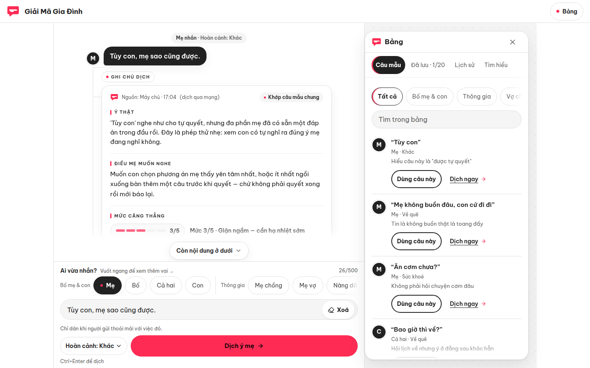
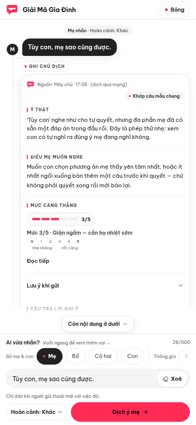
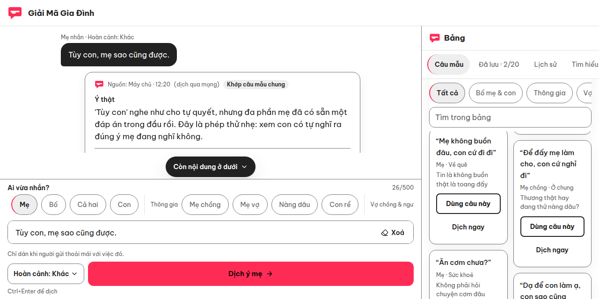
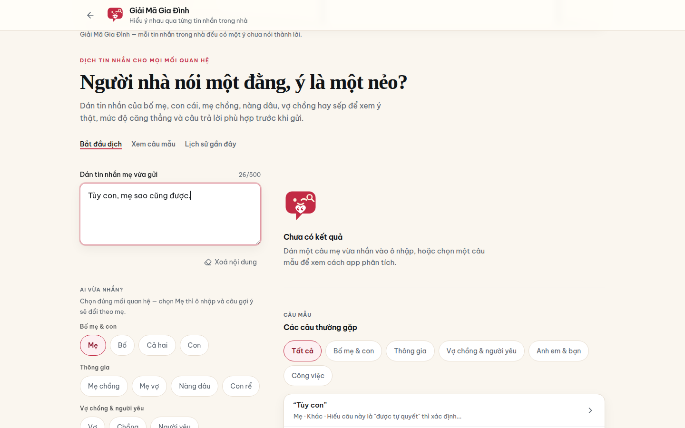
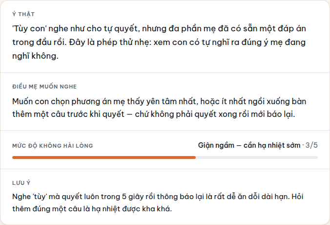
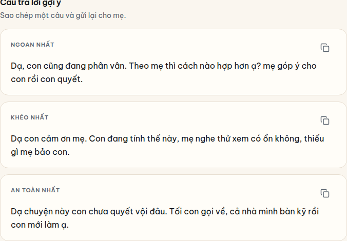
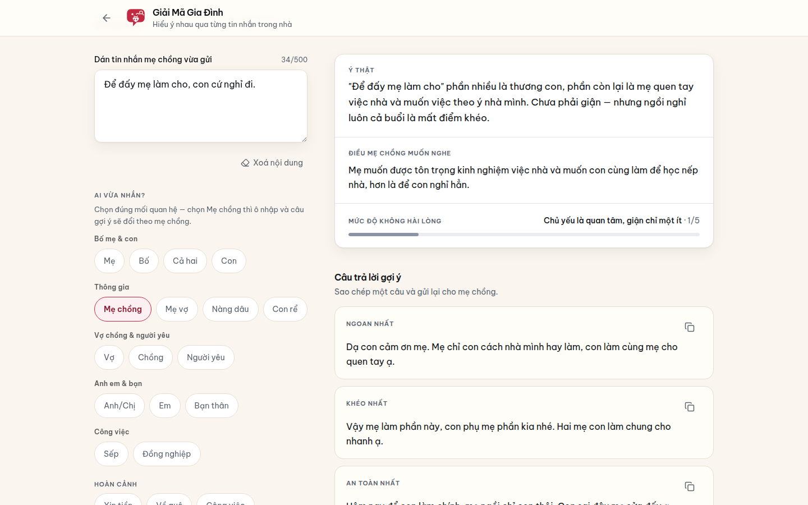

<p align="center">
  
</p>

# Giải Mã Gia Đình (dichbome)

> Decode the real meaning behind family messages — parents, kids, in-laws and partners.
>
> Người nhà nhắn “tùy” là ý gì? Dịch ý thật cho bố mẹ, con cái, thông gia và vợ chồng.

[](https://dichbome.vercel.app)
[](LICENSE)

**🔴 Live app: https://dichbome.vercel.app** — no account, no sign-up, just paste a message.
Repository: https://github.com/changvn2002/dichbome

<p align="center">
  
</p>
<p align="center"><em>Mẹ nhắn “Tùy con, mẹ sao cũng được.” — app dịch ra ý thật, điều mẹ muốn nghe, mức độ không hài lòng 3/5 và gợi ý sẵn câu trả lời. Ảnh chụp thật từ bản production đang chạy.</em></p>

**Tóm tắt (Tiếng Việt):** Dán một câu bố mẹ, con cái, mẹ chồng, nàng dâu, vợ chồng hay sếp
vừa nhắn — app cho bạn biết câu đó *thật ra nghĩa là gì*, người nhắn *đang muốn gì*, mức độ
căng thẳng tới đâu, và gợi ý sẵn 3 câu trả lời cho êm chuyện. Engine dịch là **rule-based
tiếng Việt, deterministic** — không gọi AI bên ngoài, không cần đăng nhập, không gửi dữ
liệu đi đâu.

> Classic example: Mom texts *“Tùy con, mẹ sao cũng được”* (“Up to you, I'm fine with
> anything”) — it sounds like a free choice, but the real meaning is usually that she
> already has an answer in mind and is waiting for you to ask one more question.

## ✨ Features

- **Decode any family relationship** — pick who sent the message: parents ⇄ kids, in-laws (mother-in-law ⇄ daughter-in-law), spouses & partners, siblings & friends, or work contacts. Wording, forms of address and suggested replies adapt to the role.
- **Real meaning, not literal meaning** — every decode returns the true intent (“Ý thật”), what the sender actually wants to hear, and a warning when the message is risky.
- **Tension meter** — an anger/tension level from 0–5 with a plain-language danger label.
- **3 safe reply suggestions** — ready to copy and send, in the right tone for the relationship (most obedient / smoothest / safest).
- **Examples library** — classic lines like “tùy con” (“up to you”) and “không sao đâu” (“it's fine”) pre-loaded so you can try instantly.
- **Save & share results** — share via the Web Share API (or copy a summary), keep up to 20 favourites in `localStorage`, plus a recent-history list on-device.
- **Works offline** — an offline banner appears when the network drops and decoding continues on the local rule-based engine.
- **No account needed, large touch targets** — readable type and ≥44px buttons, designed so older family members can use it too.
- **Two run modes** — `http` (default: the UI calls the Next.js route handlers built into this repo) or fully offline in the browser, where the same rule-based engine runs locally with zero backend. If the HTTP call fails, the UI automatically falls back to the offline engine and tells the user.

## 🖼️ Screenshots

Tất cả ảnh dưới đây được chụp trực tiếp từ bản production
[https://dichbome.vercel.app](https://dichbome.vercel.app) khi app đang ở trạng thái
**đã dịch xong một tin nhắn thật** — đúng những gì người dùng nhìn thấy sau khi bấm
“Dịch ý”, không phải màn hình trống lúc mới mở app hay ảnh dựng sẵn.

### Kết quả dịch — giá trị cốt lõi của app


_Trên desktop: bên trái là câu mẹ vừa nhắn và các nhóm quan hệ để chọn người gửi; bên
phải là kết quả dịch đầy đủ — **Ý thật** (“mẹ đã có sẵn một đáp án trong đầu”), **Điều
mẹ muốn nghe**, **Mức độ không hài lòng 3/5** (“Giận ngầm — cần hạ nhiệt sớm”) kèm
**Lưu ý** thực tế, và ngay bên dưới là các câu trả lời gợi ý._

| Mobile (390×844)                                                                 | Social / link-preview (1280×640)                                              |
| ------------------------------------------------------------------------------- | ----------------------------------------------------------------------------- |
|  |  |
| _Trên điện thoại, thẻ kết quả xếp dọc ngay dưới ô nhập: ý thật, điều mẹ muốn nghe và thang đo mức độ đọc rõ trong một màn hình._ | _Khung 1280×640 dùng cho ảnh xem trước khi gửi link app qua Zalo/Facebook — vẫn thấy trọn thẻ kết quả dịch._ |

### Theo từng bước sử dụng

**Bước 1 — Dán tin nhắn và chọn đúng người nhắn.** App có sẵn 16 vai trong 5 nhóm
quan hệ (Bố mẹ & con, Thông gia, Vợ chồng & người yêu, Anh em & bạn, Công việc) và thư
viện câu mẫu để thử ngay.



**Bước 2 — Đọc ý thật và mức độ căng thẳng.** Mỗi kết quả gồm ý thật phía sau câu nói,
điều người nhắn thật sự muốn nghe, thang đo mức độ không hài lòng 0–5 có nhãn cảnh báo,
và lưu ý tình huống nếu câu nói tiềm ẩn rủi ro.



**Bước 3 — Sao chép một câu trả lời êm chuyện.** Ba gợi ý theo ba tông — *Ngoan nhất*,
*Khéo nhất*, *An toàn nhất* — viết đúng cách xưng hô của mối quan hệ đã chọn, bấm một
chạm để sao chép rồi gửi lại ngay.



**Không chỉ dịch bố mẹ — cả mẹ chồng, nàng dâu, vợ chồng và sếp.** Cùng một thao tác,
đổi người nhắn là ý nghĩa và câu gợi ý đổi theo đúng nếp của mối quan hệ đó. Ví dụ dưới
đây: mẹ chồng nhắn “Để đấy mẹ làm cho, con cứ nghỉ đi.” trong hoàn cảnh ở chung — app
nhận ra đây là quan tâm là chính (mức độ 1/5) nhưng ngồi nghỉ luôn thì mất điểm khéo.



## 🧭 How it works

1. **Paste the message** someone in the family just sent you (1–500 characters).
2. **Pick who sent it** and, optionally, the situation (money, visiting home, work, weddings, health, living together, kids…).
3. **Read the decode** — real meaning, what they want to hear, the tension meter (0–5) with a danger label, any warning — then copy one of the 3 suggested replies and send it back.

## 🛠️ Tech stack

| Layer     | Technology                                                                                                                        |
| --------- | --------------------------------------------------------------------------------------------------------------------------------- |
| Framework | [Next.js 16](https://nextjs.org) (App Router) + React 19 + TypeScript 5.9 (strict)                                                |
| Styling   | Tailwind CSS 4 (via `@tailwindcss/postcss`), fonts Be Vietnam Pro / Playfair Display (Vietnamese subsets)                         |
| Icons     | lucide-react                                                                                                                      |
| Engine    | Pure rule-based Vietnamese decoder in TypeScript (`lib/server/engine.ts` + client copy in `components/dichbome/lib/translate.ts`) |
| API       | Next.js Route Handlers (`app/api/products/dichbome/*`)                                                                            |
| Tooling   | pnpm, ESLint (eslint-config-next), Prettier                                                                                       |

No AI API key is needed anywhere: the decoder is a deterministic phrase/rule dictionary.

## 🚀 Getting started

### Prerequisites

- Node.js **>= 20**
- pnpm **>= 9** (or use `npx pnpm@10 ...` / corepack)

### Install & run

```bash
git clone https://github.com/changvn2002/dichbome.git
cd dichbome
pnpm install
cp .env.example .env.local   # optional — the defaults already work
pnpm dev                     # http://localhost:3000
```

> Run fully offline with no server logic at all: set `NEXT_PUBLIC_DICHBOME_API_MODE=mock` in
> `.env.local` (the value is the offline engine's internal mode name) — the app then runs
> entirely on the real rule-based engine in the browser, the same decoder the API uses.

### Scripts

| Command                        | What it does                             |
| ------------------------------ | ---------------------------------------- |
| `pnpm dev`                     | Start the dev server                     |
| `pnpm build`                   | Production build                         |
| `pnpm start`                   | Run the production build                 |
| `pnpm typecheck`               | Type-check (`tsc --noEmit`)              |
| `pnpm lint`                    | ESLint over the whole repo               |
| `pnpm format` / `format:check` | Prettier write / check                   |

### Environment variables

| Variable                      | Default                     | Description                                                                                                                                                                              |
| ----------------------------- | --------------------------- | ---------------------------------------------------------------------------------------------------------------------------------------------------------------------------------------- |
| `NEXT_PUBLIC_DICHBOME_API_MODE` | `http`                    | `http` = call this repo's route handlers; `mock` (internal mode name) = the offline engine running locally in the browser.                                                                    |
| `NEXT_PUBLIC_API_URL`         | _(empty)_                   | Base URL for `http` mode. Empty = same-origin API (recommended). Only set it to point at a separate backend implementing the contract below.                                              |
| `NEXT_PUBLIC_SITE_URL`        | `https://dichbome.vercel.app` | Canonical origin of the production deployment, used as `metadataBase` for SEO (canonical, Open Graph, `sitemap.xml`, `robots.txt`). No trailing slash.                                   |

No secrets are required. See `.env.example` for the documented defaults.

## 🔍 SEO & PWA

The standalone ships with a complete SEO + PWA pack, no extra configuration needed:

- **Full metadata** in `app/layout.tsx` (sourced from `lib/site.ts`): Vietnamese title/description, `metadataBase` from `NEXT_PUBLIC_SITE_URL`, canonical, robots, Open Graph + Twitter cards using `public/og.png` (1200×630), brand `theme-color` `#C22A44`.
- **`app/robots.ts` + `app/sitemap.ts`** → `/robots.txt` and `/sitemap.xml` (`/api/` disallowed, sitemap points at the homepage).
- **JSON-LD** `WebApplication` (schema.org) embedded in the layout — only truthful fields (name, description, `applicationCategory`, `inLanguage: vi`); no ratings/prices/reviews.
- **Installable PWA**: `app/manifest.ts` generates `/manifest.webmanifest` (`standalone` display, cream background `#FAF6EF`, theme `#C22A44`) with 192/512 icons + a 512 maskable icon; iOS uses a 180×180 `apple-touch-icon`.
- **Icons/OG are PNGs rasterised from the official brand SVGs** by `scripts/generate-brand-pngs.mjs` (using `@resvg/resvg-js`, usage notes at the top of the script). The artwork itself is untouched: the script only rasterises the original logo for icons, and for `og.png` scales the official 1600×900 banner proportionally into the 1200×630 frame on the banner's own background colour (`#F6F1E7`) — no cropping, no recolouring. Maskable/iOS icons centre the original logo on the cream `#FAF6EF` background because those platforms reject transparency.

## 🔌 API contract

### `POST /api/products/dichbome/translate`

```jsonc
// Request
{
  "message": "Tùy con, mẹ sao cũng được",   // required, 1–500 characters
  "speaker": "me",                          // optional — role code, see below
  "context": "khac"                         // optional — situation code, see below
}

// Response 200
{
  "meaning": "…the real meaning of the message…",
  "realWant": "…what the sender wants to hear…",
  "angerLevel": 62,                          // 0–100 at the server layer
  "dangerLabel": "Giận ngầm — cần hạ nhiệt sớm",
  "replies": [
    { "label": "Ngoan nhất",   "text": "…" },
    { "label": "Khéo nhất",    "text": "…" },
    { "label": "An toàn nhất", "text": "…" }
  ],
  "warning": "…(optional)…"
}
```

- `speaker` codes: `me`, `bo`, `both` (legacy: `mom`, `dad`, `parents`), `child`, `mother-in-law`, `mother-of-wife`, `daughter-in-law`, `son-in-law`, `wife`, `husband`, `older-sibling`, `younger-sibling`, `lover`, `boss`, `coworker`, `friend`.
- `context` codes: `tien`, `ve-que`, `cong-viec`, `nguoi-yeu`, `cuoi`, `suc-khoe`, `o-chung`, `con-cai`, `khac`.
- Malformed input → `400` with body `{ statusCode, message: string[], error: "Bad Request" }`.
- The endpoint is public; no auth required.

### `GET /api/products/dichbome/examples`

Returns `{ examples: [{ message, speaker, context, tease }] }` — the static sample lines the UI suggests.

> The client normalises the server's 0–100 `angerLevel` to the 0–5 scale for display
> (see `components/dichbome/api/http.ts`).

## 📁 Project structure

```
.
├── app/
│   ├── layout.tsx                 # Fonts, full SEO metadata + JSON-LD, <html lang="vi">
│   ├── page.tsx                   # Route "/" — mounts DichbomeApp
│   ├── globals.css                # Tailwind v4 + design tokens (subset of the original host)
│   ├── robots.ts                  # → /robots.txt
│   ├── sitemap.ts                 # → /sitemap.xml
│   ├── manifest.ts                # → /manifest.webmanifest (PWA)
│   └── api/products/dichbome/
│       ├── translate/route.ts     # POST — validate + run the engine
│       └── examples/route.ts      # GET  — static sample lines
├── components/dichbome/           # The whole product (original structure preserved)
│   ├── app.tsx                    # Main UI (DichbomeApp, 'use client')
│   ├── api/                       # Client API: http + offline engine, types, mode selection
│   └── lib/translate.ts           # Local offline engine + fallback when the API is unreachable
├── lib/
│   ├── api.ts                     # Fetch helper (shim equivalent to the host's @/lib/api)
│   ├── site.ts                    # Shared site name/description/URL for metadata, robots, sitemap, manifest
│   ├── utils.ts                   # cn()
│   └── server/engine.ts           # Server-side engine (ported from the original Nest module)
├── scripts/
│   └── generate-brand-pngs.mjs    # Generate og.png + icon PNGs from brand SVGs (see SEO & PWA)
├── public/
│   ├── og.png                     # Open Graph image 1200×630 (from the official banner)
│   ├── icons/                     # PWA icons 192/512, maskable 512, apple-touch-icon 180
│   └── products/brand/            # Official logo/banner SVGs (see BRAND.md)
├── docs/
│   └── screenshots/               # Production screenshots used in this README
├── BRAND.md                       # Brand kit: colours, logo, usage rules
├── CONTENT.md                     # Content/video shooting script
├── EXTRACT.md                     # Original extraction notes from the source monorepo
└── LICENSE                        # MIT
```

## 🧑‍💻 Development

- **Add new phrases to the decoder**: edit the `ENTRIES` dictionary in `lib/server/engine.ts` (and the client copy in `components/dichbome/lib/translate.ts` if you want the offline engine to match 100%). Rule order matters: specific patterns go before generic ones; rules tagged with `speakers` win when the role matches.
- **Code style**: TypeScript `strict`, ESLint via `eslint-config-next`, Prettier (single quotes, semicolons, print width 100). Run `pnpm lint && pnpm typecheck` before committing.
- **Don't add app-specific colours to `globals.css`** — product colours are declared as local CSS vars in `components/dichbome/app.tsx` (see EXTRACT.md). Respect the brand rules in `BRAND.md` for UI changes (single accent colour `#C22A44`, no gradients).
- PRs welcome: fork → branch → PR against `main`. Describe the user-visible change and add screenshots for UI changes.

## ▲ Deploy on Vercel

The production deployment runs at **https://dichbome.vercel.app**. To deploy your own:

1. Fork/clone this repo, then in Vercel: **Add New → Project** and import it.
2. Framework preset: **Next.js** (auto-detected). Root directory: repository root.
3. Environment variables are optional — the defaults already run the full app (for a pure front-end deployment, the offline engine mode is enough; no backend, no secrets).
4. Deploy. Every push to `main` redeploys automatically.

It is a plain Next.js app, so any Node host works too (Docker, VPS):

```bash
pnpm install --frozen-lockfile
pnpm build
pnpm start
```

## 📝 Porting notes

This repo was extracted from the `dichbome` mini-app of a larger studio monorepo
(client in `client/products/dichbome`, server in `server/src/products/dichbome`).
Intentional differences from the monorepo original:

1. **NestJS backend → Next route handlers**: `DichbomeService` was ported with its logic intact into `lib/server/engine.ts` (only Nest decorators/DI removed); route-handler validation mirrors the original DTO (message 1–500 chars, speaker/context from the allowed code lists, errors returned as `400 { statusCode, message[], error }`).
2. **Host helper `@/lib/api`**: replaced by the `lib/api.ts` shim with the same signature and behaviour (attaches a JWT from `localStorage` when present, parses errors like the original); only the default base URL changed to same-origin instead of `http://localhost:5101`. Unrelated host helpers (admin upload, media URLs) were not carried over.
3. **"Back to app list" button**: in the monorepo it pointed to the host's `/apps`; in the standalone it points to `/` (this app itself) — 2 spots in `components/dichbome/app.tsx`.
4. **Test files were not carried over**: `lib/translate.spec.ts` (client) and `dichbome.service.spec.ts` (server) remain in the source repo; the engine logic is unchanged so behaviour is preserved, but this standalone repo does not yet ship its own test suite.
5. **Brand**: official SVGs live in `public/products/brand/`; the raster `dichbome-banner.webp` is only used for social posts and is intentionally not in this repo (see BRAND.md).

## 📄 License

MIT — see [LICENSE](LICENSE). © chang2tech.

The Giải Mã Gia Đình logo, mascot and wordmark in `public/products/brand/` are © chang2tech and are **not** covered by the MIT license — please replace them with your own branding in forks (see the brand assets notice in [LICENSE](LICENSE)).
