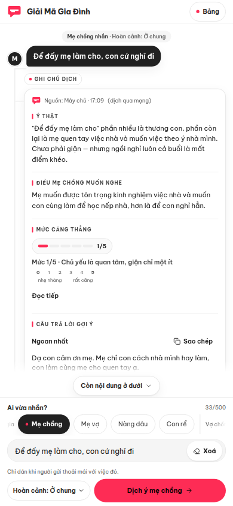
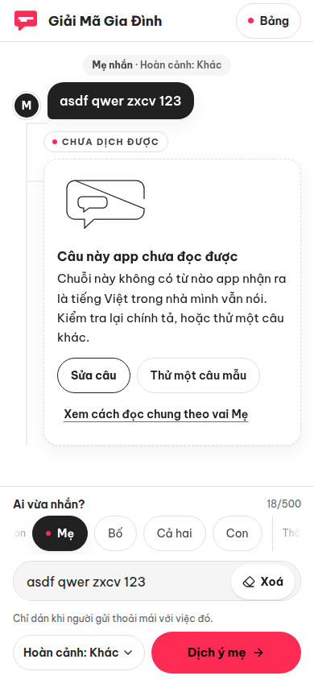
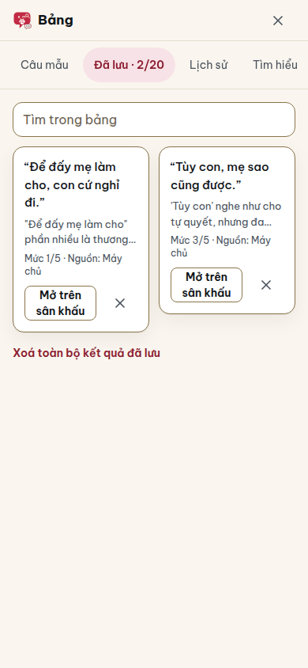
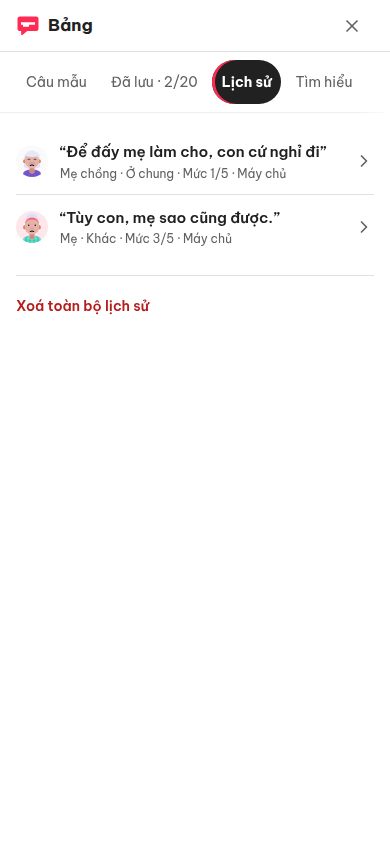

<p align="center">
  
</p>

# Giải Mã Gia Đình (dichbome)

> Decode the real meaning behind family messages — parents, kids, in-laws and partners.
>
> Người nhà nhắn “tùy” là ý gì? Dịch ý thật cho bố mẹ, con cái, thông gia và vợ chồng.

[](https://dichbome.vercel.app)
[](LICENSE)

**🔴 Live app: https://dichbome.vercel.app** — no account, no sign-up, just paste a message.
Repository: https://github.com/changvn2002/dichbome

**Tóm tắt (Tiếng Việt):** Dán một câu bố mẹ, con cái, mẹ chồng, nàng dâu, vợ chồng hay sếp
vừa nhắn — app cho bạn biết câu đó *thật ra nghĩa là gì*, người nhắn *đang muốn gì*, mức độ
căng thẳng tới đâu, và gợi ý sẵn 3 câu trả lời cho êm chuyện. Engine dịch là **rule-based
tiếng Việt, deterministic** — không gọi AI bên ngoài, không cần đăng nhập; lịch sử và mục
đã lưu chỉ nằm trên máy của bạn (xem mục Privacy & data).

> Classic example: Mom texts *“Tùy con, mẹ sao cũng được”* (“Up to you, I'm fine with
> anything”) — it sounds like a free choice, but the real meaning is usually that she
> already has an answer in mind and is waiting for you to ask one more question.

## ✨ Features

- **Decode any family relationship** — pick who sent the message: parents ⇄ kids, in-laws (mother-in-law ⇄ daughter-in-law), spouses & partners, siblings & friends, or work contacts. Wording, forms of address and suggested replies adapt to the role.
- **Real meaning, not literal meaning** — every decode returns the true intent (“Ý thật”), what the sender actually wants to hear, and a warning when the message is risky.
- **Tension meter** — an anger/tension level from 0–5 with a plain-language danger label.
- **3 safe reply suggestions** — ready to copy and send, in the right tone for the relationship (most obedient / smoothest / safest).
- **Examples library** — classic lines like “tùy con” (“up to you”) and “không sao đâu” (“it's fine”) pre-loaded so you can try instantly.
- **Save & share results** — share via the Web Share API (or copy a summary), keep up to 20 saved results in `localStorage`, plus a recent-history list on-device.
- **Works offline** — a hand-written service worker (`public/sw.js`) caches the app shell, and the rule-based engine also runs on-device, so the app opens and keeps decoding when the network drops. The server engine is the only path that needs a network, and the UI degrades to the on-device engine automatically when it is unreachable.
- **No account needed, large touch targets** — readable type and ≥44px buttons, designed so older family members can use it too.
- **Two run modes** — `http` (default: the UI calls the Next.js route handlers built into this repo) or fully offline in the browser, where a second implementation of the rule-based engine runs locally with zero backend. An automated parity suite verifies the two implementations agree on text normalisation, decode meaning, the anger scale, the example set and the validation rules. If the HTTP call fails, the UI automatically falls back to the on-device engine and tells the user.

## 📸 Screenshots

Ảnh chụp trực tiếp từ bản live https://dichbome.vercel.app (redesign «Sân Khấu Hội Thoại») — mọi ảnh đều là app thật đang chạy với kết quả giải mã thật trên màn hình.


_Phiếu giải mã ngay dưới bong bóng câu gốc: nhãn nguồn cho biết kết quả đến từ máy chủ hay dịch ngay trên máy, kèm ý thật, điều người nhắn muốn nghe và thang căng thẳng 0–5._


_Desktop: sân khấu ở giữa, cột Bảng bên phải luôn hiện thư viện câu mẫu và các tab Đã lưu / Lịch sử._



_Đổi người nhắn và hoàn cảnh thì cách đọc cũng đổi: câu “Để đấy mẹ làm cho…” của mẹ chồng ở hoàn cảnh ở chung được đọc là quan tâm là chính, giận chỉ một ít._



_Gặp câu app không nhận ra (ví dụ gõ bừa “asdf qwer zxcv 123”), app nói thẳng là chưa đọc được và gợi ý sửa câu hoặc thử câu mẫu — không bịa bản dịch cho có._



_Bảng, tab Đã lưu: giữ tối đa 20 kết quả ngay trên thiết bị, mở lại lên sân khấu hoặc xoá từng mục._



_Bảng, tab Lịch sử: các câu đã dịch gần đây kèm người nhắn, hoàn cảnh và mức căng thẳng — chạm vào để xem lại phiếu._

## 🧭 How it works

1. **Paste the message** someone in the family just sent you (1–500 characters).
2. **Pick who sent it** and, optionally, the situation (money, visiting home, work, weddings, health, living together, kids…).
3. **Read the decode** — real meaning, what they want to hear, the tension meter (0–5) with a danger label, any warning — then copy one of the 3 suggested replies and send it back.

## 🛠️ Tech stack

| Layer     | Technology                                                                                                                        |
| --------- | --------------------------------------------------------------------------------------------------------------------------------- |
| Framework | [Next.js 16](https://nextjs.org) (App Router) + React 19 + TypeScript 5.9 (strict)                                                |
| Styling   | Tailwind CSS 4 (via `@tailwindcss/postcss`), fonts Be Vietnam Pro / Fraunces (Vietnamese subsets)                         |
| Icons     | lucide-react                                                                                                                      |
| Engine    | Pure rule-based Vietnamese decoder in TypeScript — server source of truth in `lib/server/engine.ts` + on-device implementation in `components/dichbome/lib/translate.ts`, kept in agreement by an automated parity suite |
| API       | Next.js Route Handlers (`app/api/products/dichbome/*`)                                                                            |
| Tooling   | pnpm, ESLint (eslint-config-next), Prettier                                                                                       |

No AI API key is needed anywhere: the decoder is a deterministic phrase/rule dictionary.

## 🚀 Getting started

### Prerequisites

- Node.js **24.x** (pinned in `.nvmrc` and `engines`)
- pnpm **10.32.1** (pinned via `packageManager` — use corepack, or `npx -y pnpm@10.32.1`)

### Install & run

```bash
git clone https://github.com/changvn2002/dichbome.git
cd dichbome
pnpm install --frozen-lockfile
cp .env.example .env.local   # optional — the defaults already work
pnpm dev                     # http://localhost:3000
```

> Run fully offline with no server logic at all: set `NEXT_PUBLIC_DICHBOME_API_MODE=local` in
> `.env.local` — the app then runs entirely on the real rule-based engine in the browser.
> The server engine remains the source of truth; the parity suite keeps the two in agreement
> on the dimensions it measures (see Development).

### Scripts

| Command                        | What it does                             |
| ------------------------------ | ---------------------------------------- |
| `pnpm dev`                     | Start the dev server                     |
| `pnpm build`                   | Production build                         |
| `pnpm start`                   | Run the production build                 |
| `pnpm typecheck`               | Type-check (`tsc --noEmit`)              |
| `pnpm lint`                    | ESLint over the whole repo               |
| `pnpm test`                    | Unit/regression suite (Node test runner) |
| `pnpm format` / `format:check` | Prettier write / check                   |

### Environment variables

| Variable                      | Default                     | Description                                                                                                                                                                              |
| ----------------------------- | --------------------------- | ---------------------------------------------------------------------------------------------------------------------------------------------------------------------------------------- |
| `NEXT_PUBLIC_DICHBOME_API_MODE` | `http`                    | `http` = call this repo's route handlers; `local` = the offline engine running locally in the browser.                                                                    |
| `NEXT_PUBLIC_API_URL`         | _(empty)_                   | Base URL for `http` mode. Empty = same-origin API (recommended). Only set it to point at a separate backend implementing the contract below.                                              |
| `NEXT_PUBLIC_SITE_URL`        | `https://dichbome.vercel.app` | Canonical origin of the production deployment, used as `metadataBase` for SEO (canonical, Open Graph, `sitemap.xml`, `robots.txt`). No trailing slash.                                   |

No secrets are required. See `.env.example` for the documented defaults.

## 🔍 SEO & PWA

The standalone ships with a complete SEO + PWA pack, no extra configuration needed:

- **Full metadata** in `app/layout.tsx` (sourced from `lib/site.ts`): Vietnamese title/description, `metadataBase` from `NEXT_PUBLIC_SITE_URL`, canonical, robots, Open Graph + Twitter cards using `public/og.png` (1200×630), brand `theme-color` `#C22A44`.
- **`app/robots.ts` + `app/sitemap.ts`** → `/robots.txt` and `/sitemap.xml` (`/api/` disallowed, sitemap points at the homepage).
- **JSON-LD** `@graph` with `WebSite` + `WebApplication` + `FAQPage` (schema.org) embedded in the layout — only truthful fields; the app is free, so the `Offer` is `price: 0` VND; no ratings/reviews.
- **Installable PWA**: `app/manifest.ts` generates `/manifest.webmanifest` (`standalone` display, cream background `#FAF6EF`, theme `#C22A44`) with 192/512 icons + a 512 maskable icon; iOS uses a 180×180 `apple-touch-icon`.
- **Icons/OG are v2 assets built from source SVGs in the redesign asset pack**: `public/og.png` (1200×630) and the PWA icons are rasterised from the pack's hand-built SVG sources with its `build-assets` script (resvg) — real product artwork (a two-bubble conversation scene with real text set in Fraunces + Be Vietnam Pro), not a scaled banner. Maskable/iOS icons keep the mark intact on the cream `#FAF6EF` background because those platforms reject transparency.

## 🔌 API contract

### `POST /api/products/dichbome/translate`

```jsonc
// Request
{
  "message": "Tùy con, mẹ sao cũng được",   // required, 1–500 characters
  "speaker": "me",                          // optional — role code, see below
  "context": "khac"                         // optional — situation code, see below
}

// Response 200
{
  "meaning": "…the real meaning of the message…",
  "realWant": "…what the sender wants to hear…",
  "angerLevel": 62,                          // 0–100 at the server layer
  "dangerLabel": "Giận ngầm — cần hạ nhiệt sớm",
  "replies": [
    { "label": "Ngoan nhất",   "text": "…" },
    { "label": "Khéo nhất",    "text": "…" },
    { "label": "An toàn nhất", "text": "…" }
  ],
  "warning": "…(optional)…"
}
```

- `speaker` codes: `me`, `bo`, `both` (legacy: `mom`, `dad`, `parents`), `child`, `mother-in-law`, `mother-of-wife`, `daughter-in-law`, `son-in-law`, `wife`, `husband`, `older-sibling`, `younger-sibling`, `lover`, `boss`, `coworker`, `friend`.
- `context` codes: `tien`, `ve-que`, `cong-viec`, `nguoi-yeu`, `cuoi`, `suc-khoe`, `o-chung`, `con-cai`, `khac`.
- All errors use one shape: `{ error: { code, message, fields? } }`. Unknown JSON fields are rejected with `400` (`UNKNOWN_FIELD`, offending names in `fields`); validation failures return `400` (`VALIDATION_ERROR`); malformed JSON returns `400` (`INVALID_JSON`); a body over 8,192 characters returns `413` (`PAYLOAD_TOO_LARGE`).
- The endpoint is public; no auth required.

### `GET /api/products/dichbome/examples`

Returns `{ examples: [{ message, speaker, context, tease }] }` — the static sample lines the UI suggests.

> The client normalises the server's 0–100 `angerLevel` to the 0–5 scale for display
> (see `components/dichbome/api/http.ts`).

## 🔒 Privacy & data

- **Everything you save stays on your device.** History (up to 8 items), saved results (up to 20) and your sender/situation preferences live only in your browser's `localStorage`. There is no account and no user database.
- **Decoding in `http` mode sends the message to this app's own built-in API** (same origin), which processes it in memory and stores nothing — no database, no content logs. In `local` mode, and whenever the network drops, decoding happens entirely on your device and nothing is sent at all. Every result is labelled with where it was decoded (server / on-device).
- **Third parties**: the only external processor is the hosting platform (Vercel) that serves the site and runs the API; fonts are self-hosted, there is no analytics or tracking, and Web Vitals are measured on-device only (console, never transmitted). Full inventory: [docs/THIRD-PARTIES.md](docs/THIRD-PARTIES.md).
- **Deleting your data**: remove items in the app (delete has an 8-second undo), or clear the site's data in your browser — that erases everything, because nothing exists anywhere else.

## 🏗️ Architecture

One page + two built-in API routes; no database. The UI calls a small `DichbomeApi` contract that resolves to either the HTTP route handlers (server engine, the source of truth) or the on-device engine; all browser storage goes through a single versioned adapter. Full map, route rendering table and decisions: [docs/ARCHITECTURE.md](docs/ARCHITECTURE.md) and [docs/adr/](docs/adr/).

## 💬 Support

Maintained by **chang2tech**. Bugs and suggestions: open a GitHub Issue in this repository. Security reports: see [SECURITY.md](SECURITY.md) — please use the private advisory channel, not a public issue.

## 📁 Project structure

```
.
├── app/
│   ├── layout.tsx                 # Fonts, full SEO metadata + JSON-LD, <html lang="vi">
│   ├── page.tsx                   # Route "/" — mounts DichbomeApp
│   ├── globals.css                # Tailwind v4 + design tokens (subset of the original host)
│   ├── robots.ts                  # → /robots.txt
│   ├── sitemap.ts                 # → /sitemap.xml
│   ├── manifest.ts                # → /manifest.webmanifest (PWA)
│   └── api/products/dichbome/
│       ├── translate/route.ts     # POST — validate + run the engine
│       └── examples/route.ts      # GET  — static sample lines
├── components/dichbome/           # The whole product (original structure preserved)
│   ├── app.tsx                    # Main UI (DichbomeApp, 'use client')
│   ├── api/                       # Client API: http + local engine, types, mode selection
│   ├── web-vitals.tsx             # On-device-only RUM reporter (console, never transmitted)
│   └── lib/                       # translate.ts (on-device engine), honesty.ts, clipboard.ts, undo.ts, storage.ts (versioned adapter)
├── lib/
│   ├── api.ts                     # Token-free same-origin fetch helper (error parsing matches the API error shape)
│   ├── site.ts                    # Shared site name/description/URL for metadata, robots, sitemap, manifest
│   ├── utils.ts                   # cn()
│   └── server/                    # engine.ts (source of truth) + translate-handler.ts + api-errors.ts
├── scripts/
│   ├── generate-brand-pngs.mjs    # Legacy brand-PNG generator — v2 og.png/icons come from the redesign asset pack (see SEO & PWA)
│   └── check-bundle-budget.mjs    # First-load JS budget gate (perf-budget.json), run in CI
├── public/
│   ├── og.png                     # Open Graph image 1200×630 (v2 asset, built from the redesign pack's SVG source)
│   ├── icons/                     # PWA icons 192/512, maskable 512, apple-touch-icon 180
│   └── products/brand/            # Official logo/banner SVGs (see BRAND.md)
├── docs/
│   ├── screenshots/               # Production screenshots of the live redesign — shown in the Screenshots section above
│   ├── ARCHITECTURE.md            # Layer map + per-route rendering
│   ├── adr/                       # ADR-001 dual-engine parity, ADR-002 perf budget
│   ├── THIRD-PARTIES.md           # DATA-08 third-party inventory
│   ├── RUNBOOK-ROLLBACK.md        # OPS-04 rollback procedure + tag↔deployment pairing
│   └── QA-BUG-TEST-MAP.md         # Which regression test locks which fixed bug
├── tests/                         # Node test runner suite (pnpm test) + tests-evidence/ (parity & perf evidence)
├── BRAND.md                       # Brand kit: colours, logo, usage rules
├── CONTENT.md                     # Content/video shooting script
├── EXTRACT.md                     # Repo structure notes (modes, storage, contract pointers)
├── CHANGELOG.md                   # Release history (Keep a Changelog)
├── SECURITY.md                    # How to report a vulnerability (RFC 9116 contact in /.well-known/security.txt)
├── NOTICE                         # Brand-assets exclusion from the MIT license
└── LICENSE                        # MIT (text only)
```

## 🧑‍💻 Development

- **Add new phrases to the decoder**: edit the `ENTRIES` dictionary in the server engine (`lib/server/engine.ts`) FIRST — it is the source of truth — then mirror the change in the on-device engine (`components/dichbome/lib/translate.ts`). The automated parity suite (`tests-evidence/engine-parity.test.mjs`) must stay at 8/8: it verifies the two implementations agree on text normalisation, decode meaning, the anger scale, the example set and the validation rules. `realWant`, suggested replies and non-parent fallbacks are implementation-specific by design (see `docs/adr/ADR-001-dual-engine-parity.md`). Rule order matters: specific patterns go before generic ones; rules tagged with `speakers` win when the role matches.
- **Code style**: TypeScript `strict`, ESLint via `eslint-config-next`, Prettier (single quotes, semicolons, print width 100). Run `pnpm lint && pnpm typecheck` before committing.
- **Don't add app-specific colours to `globals.css`** — product colours are declared as local CSS vars in `components/dichbome/app.tsx` (see EXTRACT.md). Respect the brand rules in `BRAND.md` for UI changes (single accent colour `#C22A44`, no gradients).
- PRs welcome: fork → branch → PR against `main`. Describe the user-visible change and add screenshots for UI changes.

## ▲ Deploy on Vercel

The production deployment runs at **https://dichbome.vercel.app**. To deploy your own:

1. Fork/clone this repo, then in Vercel: **Add New → Project** and import it.
2. Framework preset: **Next.js** (auto-detected). Root directory: repository root.
3. Environment variables are optional — the defaults already run the full app (for a pure front-end deployment, the offline engine mode is enough; no backend, no secrets).
4. Deploy. Every push to `main` redeploys automatically.

It is a plain Next.js app, so any Node host works too (Docker, VPS):

```bash
pnpm install --frozen-lockfile
pnpm build
pnpm start
```

## 📝 Porting notes

This repo was extracted from the `dichbome` mini-app of a larger studio monorepo
(client in `client/products/dichbome`, server in `server/src/products/dichbome`).
Intentional differences from the monorepo original:

1. **NestJS backend → Next route handlers**: `DichbomeService` was ported with its logic intact into `lib/server/engine.ts` (only Nest decorators/DI removed); route-handler validation mirrors the original DTO (message 1–500 chars, speaker/context from the allowed code lists). Since fix wave 3 the handlers reject unknown fields and return one error shape — `{ error: { code, message, fields? } }` (see the API contract above).
2. **Host helper `@/lib/api`**: replaced by `lib/api.ts`, a same-origin fetch helper for this app's own routes. The original host helper's login-token behaviour was dropped in fix wave 3: the app has no accounts, and no code reads or sends any token. Unrelated host helpers (admin upload, media URLs) were not carried over.
3. **"Back to app list" button**: in the monorepo it pointed to the host's `/apps`; in the standalone it points to `/` (this app itself) — 2 spots in `components/dichbome/app.tsx`.
4. **Tests**: the original spec files stayed in the source monorepo, but this repo ships its own suite — `pnpm test` (golden corpus, honesty layer, API-route battery, storage migration, CSP) plus the parity/perf evidence suites in `tests-evidence/`, all gated in CI. See `docs/QA-BUG-TEST-MAP.md`.
5. **Brand**: official SVGs live in `public/products/brand/`; the raster `dichbome-banner.webp` is only used for social posts and is intentionally not in this repo (see BRAND.md).

## 📄 License

MIT — see [LICENSE](LICENSE). © chang2tech.

The Giải Mã Gia Đình logo, mascot and wordmark in `public/products/brand/` are © chang2tech and are **not** covered by the MIT license — please replace them with your own branding in forks (see [NOTICE](NOTICE)).
